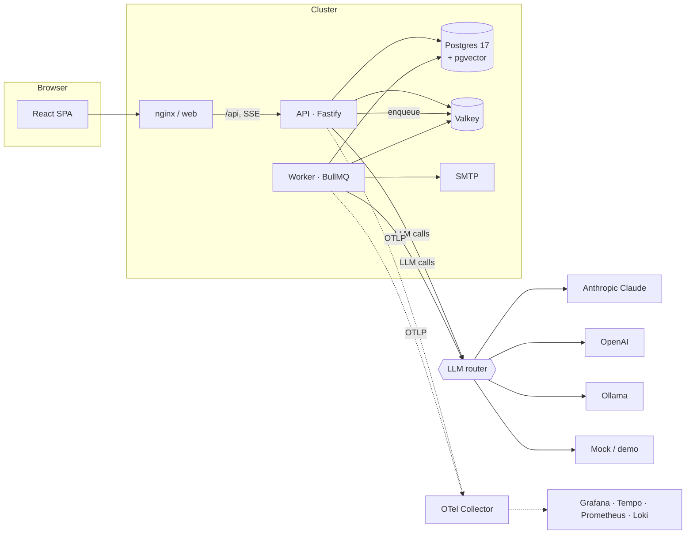

# LifeOS

**An LLM-powered personal assistant that helps people organize their lives, built as a production-style TypeScript platform.**

LifeOS turns everyday input like _"renew passport next month, high prio"_ into structured tasks, and answers questions such as _"what did I decide about car insurance?"_ from your notes. It sends a morning briefing and delivers reminders by email. The assistant chat can read your data and propose changes, but it never changes anything without your explicit approval.

The project is also built to show platform-engineering work. It's a typed monorepo with a provider-agnostic LLM layer and background workers. It ships hardened container images, a Helm chart verified on Kubernetes, OpenTelemetry tracing, cost accounting for every LLM call, and CI that blocks merges on tests, vulnerability scans and Kubernetes schema validation.

[](https://github.com/OWNER/lifeos/actions/workflows/ci.yml)

---

## Features

|                          | What it does                                                                                                                                                                      | How the LLM helps                                                                                                                     |
| ------------------------ | --------------------------------------------------------------------------------------------------------------------------------------------------------------------------------- | ------------------------------------------------------------------------------------------------------------------------------------- |
| **Quick capture** (`⌘K`) | Type anything and get a structured preview (task or note, due date, reminder, priority, tags, project) that you can adjust before saving.                                         | Extracts the fields and copies date phrases verbatim. Dates are then resolved deterministically in your timezone, never by the model. |
| **Tasks & projects**     | Inbox, Today (due or overdue), Upcoming, Done, priorities, tags, projects.                                                                                                        | n/a (plain code)                                                                                                                      |
| **Notes & journal**      | Markdown notes with autosave and **hybrid search**: Postgres full-text plus pgvector similarity, merged with Reciprocal Rank Fusion.                                              | Embeddings for semantic matching                                                                                                      |
| **Assistant chat**       | Streaming agent with tools (`list_tasks`, `search_notes`, `create_task`, `update_task`, `complete_task`, `create_note`, …). **Every write appears as a confirmation card first.** | Tool use and an agent loop                                                                                                            |
| **Reminders**            | In-app notifications and email, delivered exactly once, with a sweeper that recovers jobs if Redis loses them.                                                                    | n/a                                                                                                                                   |
| **Daily briefing**       | A short plan for the day, generated at your configured local time.                                                                                                                | Summarizes and prioritizes                                                                                                            |
| **AI usage dashboard**   | Cost, tokens, p95 latency and error rate by feature and model.                                                                                                                    | n/a (accounting for every call)                                                                                                       |

Runs **with zero API keys**: a deterministic mock provider powers a demo mode, and you can plug in Claude, OpenAI or a local Ollama model.

## Architecture



| Layer    | Choice                                                  | Why                                                                                      |
| -------- | ------------------------------------------------------- | ---------------------------------------------------------------------------------------- |
| Monorepo | pnpm workspaces + Turborepo                             | Build caching; `turbo prune` gives lean, per-app Docker contexts                         |
| API      | Fastify 5 + zod type provider                           | Fast and typed end to end; OpenAPI (`/api/openapi.json`) generated from the same schemas |
| Data     | Postgres 17 + pgvector, Drizzle ORM                     | One database for relational data, full-text and vectors; plain SQL migrations            |
| Jobs     | BullMQ on Valkey                                        | Delayed jobs, retries with backoff, idempotent repeatable schedulers                     |
| LLM      | Own provider interface: Anthropic, OpenAI, Ollama, mock | Swap or fall back between vendors; unit-testable without network access                  |
| Web      | React 19, Vite, TanStack Query, Tailwind v4             | Small, fast SPA served by unprivileged nginx with a strict CSP                           |
| Deploy   | Distroless images, Helm, kind, GitHub Actions           | Production patterns you can run on a laptop                                              |

More detail: [docs/architecture.md](docs/architecture.md) · decisions: [docs/adr](docs/adr) · security: [docs/threat-model.md](docs/threat-model.md)

```
apps/
  api/        Fastify HTTP API, SSE chat, health probes, graceful shutdown
  worker/     BullMQ processors: embeddings, reminders, briefings, maintenance
  web/        React SPA
packages/
  config/     zod-validated environment (fail fast on bad config)
  domain/     schemas and pure logic: timezone-safe date resolution, chunking
  db/         Drizzle schema, SQL migrations, Testcontainers fixtures
  core/       application services shared by api and worker
  llm/        providers, router, tool registry, agent loop, cost accounting
  observability/ pino logger (redaction, trace correlation), OTel bootstrap, metrics
deploy/
  helm/lifeos  chart: api, worker, web, migration hook, HPA, PDB, NetworkPolicy, Gateway API
  kind/        local cluster config and backing services
  otel/, grafana/  collector pipeline and provisioned dashboard
docker/        multi-stage Dockerfiles (distroless Node, nginx-unprivileged)
e2e/           Playwright smoke tests
```

## Quick start

Requirements: Docker and Node 24 (`nvm use`), pnpm via Corepack (`corepack enable`).

```bash
# Option A: everything in containers (demo mode, no keys needed)
docker compose --profile app up -d --build --wait
open http://localhost:8080                # Mailpit (reminder emails): http://localhost:8025

# Option B: hot-reload development
pnpm install
make dev                                  # infra + migrations + api :3000, worker, web :5173
```

### Connect a model

Copy `.env.example` to `.env` and set one of:

```bash
ANTHROPIC_API_KEY=sk-ant-...      # chat, capture and briefings on Claude Opus 5.5
OPENAI_API_KEY=sk-...             # also enables OpenAI embeddings
# or run local models with no key at all:
docker compose --profile ollama up -d    # pulls qwen3:4b + nomic-embed-text
```

`LLM_PROVIDER=auto` (default) picks Anthropic, then OpenAI, then a reachable Ollama, then the mock. Embeddings resolve separately (Anthropic has no embeddings API), and all providers use 768 dimensions so the same pgvector column serves every one. Quick capture runs at `effort: low`; set `ANTHROPIC_MODEL_FAST=claude-haiku-5-5` to make it cheaper.

## The LLM layer

- **One interface, four providers.** `ChatProvider` has `generate`, `stream` and `generateObject` (structured output validated by zod). Adapters translate to each vendor's wire format, so the rest of the app never sees vendor types.
- **Agent loop with human confirmation.** Read tools run immediately, in parallel. Write tools never run inside the loop; they're stored as `pending_actions` and shown to the user. Approval is a compare-and-set on the run, so a double click or a second tab can't execute an action twice (covered by a concurrent-approval test).
- **Prompt-injection defences** ([threat model](docs/threat-model.md)): note content goes to the model wrapped in `<untrusted_document>`, every write needs explicit approval, there are no exfiltration tools, rendered Markdown blocks raw HTML and remote images, the CSP restricts connections to the same origin, and the user id always comes from the session, never from model output. A test runs a "compromised" model through a hostile note and asserts nothing is written.
- **Append-only history.** Each user turn carries its own `<context>` block, and Claude's responses are replayed byte-for-byte. This keeps prompt caching effective and Claude's thinking blocks valid across tool turns.
- **Claude specifics.** Thinking is adaptive and depth is controlled with `output_config.effort`. Server-side refusal fallback is on (`fallbacks: "default"`). Tools are sent in sorted order and the system prompt is cached. Structured output uses `messages.parse` with zod.
- **Cost and reliability.** Every call writes an `llm_calls` row (tokens, cache hits, USD, latency, trace id) and emits `gen_ai.*` metrics. There's a per-user daily token budget in Redis, timeouts per feature, and SDK retries with backoff. Streams are never retried after the first token.

## Platform

- **Images:** multi-stage builds with BuildKit cache mounts, `turbo prune`, and `pnpm deploy --prod`. They run on **distroless** Node (UID 65532) and **nginx-unprivileged**, work with a read-only root filesystem, and carry OCI labels. CI fails on any fixable HIGH/CRITICAL CVE (Trivy).
- **Runtime:**
  - `/livez` checks the event loop only; `/readyz` checks Postgres, Redis, migration version and shutdown state.
  - SIGTERM fails readiness first, then drains in-flight requests and SSE streams, then closes connections. On kind, a rolling restart under continuous requests had **0 failed requests out of 168**.
- **Helm chart:** hardened pod security (non-root, read-only root filesystem, all capabilities dropped, seccomp, no service-account token); migrations as a `pre-install/pre-upgrade` hook with an advisory lock; HPA, PDBs, topology spread; default-deny NetworkPolicies; Gateway API `HTTPRoute` or Ingress; a strict `values.schema.json`; and a `helm test` smoke pod.
- **Observability:** OpenTelemetry traces follow HTTP → `agent.run` → `llm.chat` → `tool.execute` → Redis. postgres.js has no OTel instrumentation yet, so SQL queries don't appear as spans. Metrics cover LLM cost, tokens, latency, reminder-delivery lag (SLO: p95 < 60 s), job outcomes and agent steps. Logs are pino JSON with `trace_id` and redaction of personal content. `make observability` brings up Grafana with a provisioned dashboard.
- **CI/CD:**
  - **Every PR:** lint, typecheck, unit tests with coverage, integration tests against real Postgres and Valkey (Testcontainers), Docker builds with hadolint and Trivy, `helm lint` plus kubeconform, Playwright end-to-end tests on Docker Compose, a kind cluster deployment with `helm test`, and CodeQL.
  - **On a `v*` tag:** multi-arch images with SBOM and SLSA provenance, cosign keyless signing, and the chart published to GHCR as an OCI artifact.

```bash
make kind-up kind-deploy     # local Kubernetes: build, load, install, helm test
kubectl -n lifeos port-forward svc/lifeos-web 8080:80
```

## Testing

```bash
pnpm test               # unit tests: domain, LLM adapters (contract tests with a stubbed fetch), agent loop
pnpm test:integration   # API, services and worker against real Postgres + Valkey (Testcontainers)
pnpm exec playwright test   # browser end-to-end tests against a running stack
```

The integration suites cover auth and CSRF, tenant isolation, exactly-once action approval, prompt-injection resistance, hybrid search, exactly-once reminder delivery, sweeper recovery, and briefing scheduling across timezones.

## Roadmap

- Time-blocking calendar and "plan my day" that turns suggestions into calendar blocks
- Habits with recurrence rules and streaks, weekly review, editable assistant memory
- Goals broken into milestones and tasks
- ICS export / Google Calendar sync, Web Push
- KEDA scaling on queue depth, Argo CD GitOps, nightly LLM evals for capture accuracy

## License

MIT
