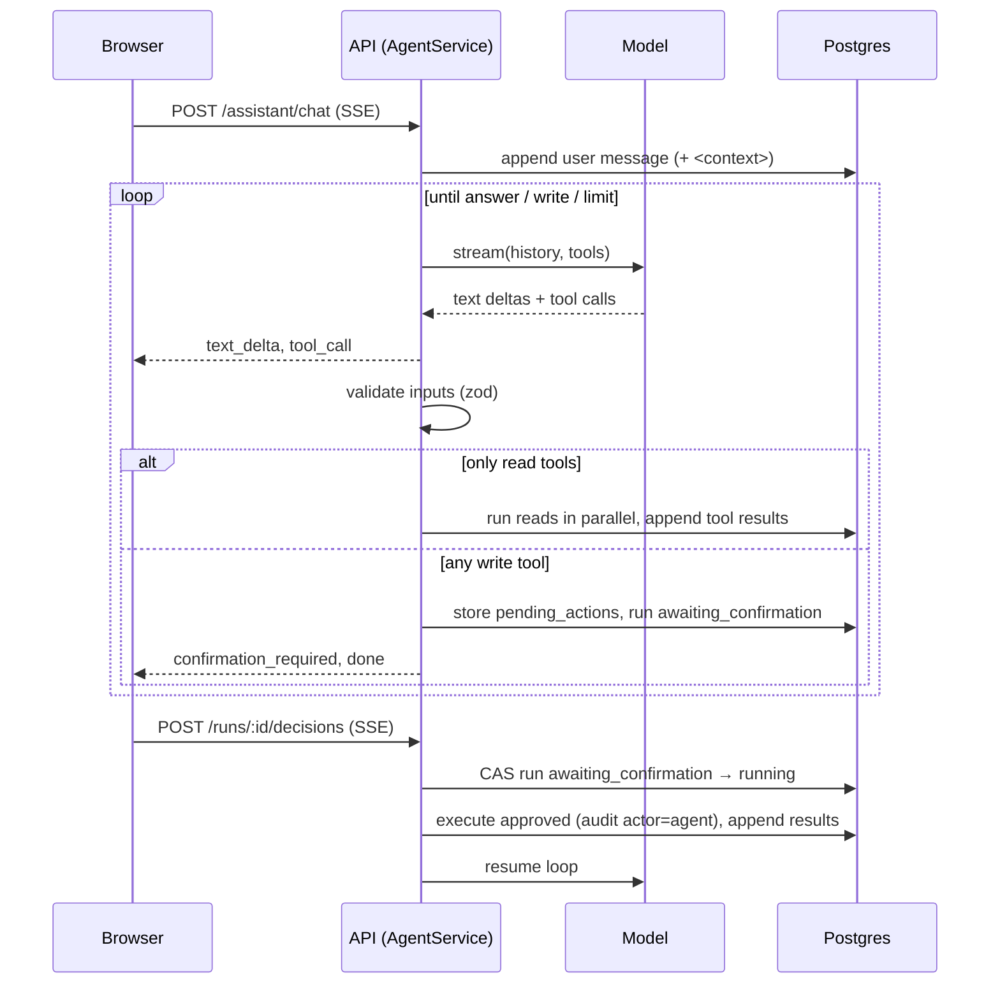

# Architecture

## Components

| Component                  | Responsibility                                                                                                | Scales by                                                      |
| -------------------------- | ------------------------------------------------------------------------------------------------------------- | -------------------------------------------------------------- |
| **web**                    | Static React SPA behind unprivileged nginx. Same-origin proxy of `/api` (SSE-aware), strict CSP.              | Replicas (stateless)                                           |
| **api**                    | Fastify HTTP API: auth, CRUD, quick capture, assistant chat over SSE, health probes. Enqueues jobs.           | HPA on CPU                                                     |
| **worker**                 | BullMQ consumers: note embedding, reminder delivery, daily briefings, maintenance (sweeper, session purge).   | Replicas / concurrency (KEDA on queue depth is on the roadmap) |
| **Postgres 17 + pgvector** | System of record: users, tasks, notes, chunks + embeddings, conversations, pending actions, reminders, usage. | Managed service in production                                  |
| **Valkey**                 | BullMQ queues, rate-limit counters, daily token budgets. Holds nothing that can't be rebuilt.                 | Managed service                                                |

Workspace packages keep the boundaries explicit: `domain` (pure logic, no I/O) ← `db` (schema) ← `core` (services) ← `api`/`worker`. `llm` is provider plumbing with no knowledge of the database; `core` injects persistence (usage sink, budget) into it.

## Request flows

### Quick capture

1. `POST /api/capture/preview` → `CaptureService.preview` asks the fast tier for a zod-validated extraction (`generateObject`). The model returns _verbatim_ date phrases.
2. `resolveDatePhrase` (chrono-node + `@date-fns/tz`) turns phrases into instants in the user's IANA timezone. That logic is unit-tested across DST and in both directions from UTC.
3. The user edits the preview; `POST /api/capture` creates the task, the optional reminder row, and a delayed BullMQ job.

### Assistant chat

Invariants:

- Every `tool_call` in history is followed by exactly one `tool_result` in a single message. Abandoned or interrupted runs are repaired with explicit "not executed" results.
- History is append-only. Assistant turns store provider-native content (`providerRaw`) and are replayed unchanged.
- The user id in tool context comes from the session, never from model output.

### Reminders

`reminders` rows are durable; BullMQ delayed jobs (`jobId = reminder-<id>`) are the fast path. Delivery claims the row with a conditional `UPDATE … WHERE status='pending' AND remind_at <= now()+5s`, so delivery is exactly-once under retries and duplicate jobs. A failed send releases the claim so the next attempt can deliver. Every minute a sweeper re-enqueues pending reminders more than 30 seconds overdue, which bounds the impact of losing Redis data. The `lifeos_reminder_lag_seconds` histogram measures the SLO (p95 < 60 s).

### Note indexing

Saving a note enqueues `embed-<noteId>-<version>`. The indexer chunks markdown (~1.2k chars, with overlap and the title prefixed), embeds only chunks whose content hash changed, replaces the chunk set in a transaction, and marks the note indexed only if it wasn't edited meanwhile (compare-and-set on `updated_at`, stored at millisecond precision). Search fuses full-text (`ts_rank_cd`, weighted title/body) and pgvector cosine similarity (HNSW, `iterative_scan` so per-user filtering doesn't starve results) with Reciprocal Rank Fusion.

## Data model (abridged)

`users` · `sessions` (sha256 of the token) · `projects` · `tasks` (soft delete, tags GIN) · `reminders` (partial index on pending) · `notifications` · `notes` (generated weighted `tsvector`, GIN) · `note_chunks` (`vector(768)`, HNSW) · `conversations` · `messages` (provider-neutral parts JSON) · `agent_runs` · `pending_actions` · `briefings` (unique per user/day) · `llm_calls` · `audit_log`. All ids are UUIDv7 (time-ordered).

## Failure modes

| Failure                          | Effect                                                       | Mitigation                                                                                                             |
| -------------------------------- | ------------------------------------------------------------ | ---------------------------------------------------------------------------------------------------------------------- |
| LLM provider down / rate limited | Chat and capture fail with a friendly error; CRUD unaffected | SDK retries + backoff; server-side refusal fallback; switch `LLM_PROVIDER`; [runbook](runbooks/llm-provider-outage.md) |
| Redis data loss                  | Delayed jobs lost                                            | Reminder sweeper; embedding jobs re-enqueued on next edit; rate limits reset                                           |
| Worker crash mid-job             | Job retried after lock expiry                                | All processors idempotent (CAS claims, content hashes, unique indexes)                                                 |
| API pod killed mid-stream        | Chat stream cut                                              | Readiness flips first; streams drain within grace; history auto-repaired on next message                               |
| Runaway agent                    | Cost spike                                                   | `maxSteps`, per-run token cap, per-user daily budget, timeouts per feature                                             |
